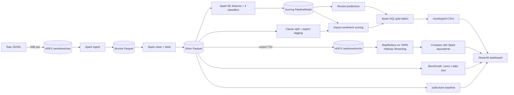

# Scalable Aspect-Based Sentiment Analysis of E-commerce Product Reviews using Hadoop and Apache Spark

A Hadoop + Spark pipeline that stores Amazon product reviews in HDFS, cleans them at scale, trains and compares sentiment classifiers with Spark MLlib, breaks sentiment down by product aspect (battery, price, delivery, ...), runs classic MapReduce jobs on YARN for comparison, benchmarks scalability, and shows the results in a Streamlit dashboard.

## Architecture



## What it does

- **Storage:** raw, bronze, silver, models and MapReduce data live in HDFS (medallion layout).
- **Cleaning:** distributed cleaning pipeline with a cleaning funnel; binary labels (4-5 stars positive, 1-2 negative, 3 dropped).
- **Classification:** negation-aware TF-IDF (unigrams + bigrams) with Logistic Regression, Naive Bayes, Linear SVC and a reduced Random Forest, compared on macro-F1, ROC-AUC and more.
- **Aspect-based sentiment:** keyword lexicon + clause-level scoring with the Logistic Regression model, validated on a 154-review labelled sample (see Limitations).
- **MapReduce:** two Hadoop Streaming jobs on YARN (word frequency per sentiment, per-product stats), verified against Spark.
- **Scalability:** runtime vs data size and vs cores, plus a scikit-learn single-machine baseline.
- **Dashboard:** Streamlit app reading pre-computed CSVs from `results/`.

## Quick start (on the committed sample, no HDFS needed)

Inside WSL2 Ubuntu, from the repo root:

```bash
python3 -m venv .venv && source .venv/bin/activate
pip install -r requirements.txt
export JAVA_HOME=/usr/lib/jvm/java-17-openjdk-amd64     # check the path with: ls /usr/lib/jvm
pytest -q                                               # gate: all tests must pass
bash scripts/run_sample.sh                              # results land in results_sample/
```

The sample (`data/sample/`) is created by `scripts/make_sample.py` (see below). Use Python 3.10 or 3.11.

## Full run (WSL2, Hadoop started, venv active)

```bash
start-dfs.sh && start-yarn.sh

# data
python scripts/download_data.py --category Cell_Phones_and_Accessories --max-rows 1000000
python scripts/make_sample.py --reviews data/raw/Cell_Phones_and_Accessories.jsonl \
    --meta data/raw/meta_Cell_Phones_and_Accessories.jsonl --out data/sample --n 20000
hdfs dfs -put -f data/raw/Cell_Phones_and_Accessories.jsonl data/raw/meta_Cell_Phones_and_Accessories.jsonl /sentiment/raw/

# main pipeline
python -m src.ingest
python -m src.clean
python -m src.train
python -m src.predict
python -m src.aspects
python -m src.analytics

# aspect validation (label data/validation/aspect_sample.csv by hand in between)
python -m scripts.export_annotation_sample
python -m src.aspect_validation

# MapReduce
python -m src.mr_export
bash hadoop_streaming/run_mapreduce.sh
python -m src.mr_compare

# benchmarks
python -m src.make_bench_subsets
python -m src.benchmark
rm -rf data/bench_local && mkdir -p data/bench_local
for p in 10 25 50 100; do hdfs dfs -get /sentiment/bench/silver_$p data/bench_local/; done
python -m src.baseline_sklearn
python -m src.benchmark_summary

# dashboard
streamlit run dashboard/Home.py
```

Experiments E2-E5 (unigram only, default stopwords, no class weights, temporal split) are config variants in `config/e2.yaml` to `config/e5.yaml`, each with its own `train.experiment_name`.

## Repository structure

```
config/             config.yaml, config.sample.yaml, aspects.yaml
src/                ingest, clean, features, train, predict, aspects, analytics,
                    aspect_validation, mr_export, mr_compare, benchmark*, baseline_sklearn
hadoop_streaming/   MapReduce mappers/reducers and run_mapreduce.sh
scripts/            download_data, make_sample, export_annotation_sample, run_sample.sh
dashboard/          Streamlit app (Home + 4 pages)
notebooks/          01_eda.ipynb, 02_error_analysis.ipynb
tests/              pytest suite (Spark and pure-Python tests)
data/               sample/ and validation/ are committed; everything else is git-ignored
results/            small committed outputs (metrics, gold CSVs, benchmarks, figures)
```

## Tech stack

Windows 11 + WSL2 Ubuntu, Python 3.10/3.11, OpenJDK 17, Hadoop 3.5.0 (single-node, pseudo-distributed), Apache Spark / PySpark 3.5.1 (MLlib, Spark SQL), Parquet, scikit-learn, Streamlit, Plotly.

## Limitations

- The "cluster" is a single node, so scalability results show parallel scaling on one machine, not network-cluster behavior.
- Language filtering is a crude ASCII-ratio heuristic; no Hinglish, sarcasm or 3-class sentiment.
- The model is trained on whole reviews but applied to clauses (domain shift); keyword aspect matching misses implicit aspects and has ambiguous words.
- Aspect validation uses a single annotator, which was an AI assistant and not a human, and measures precision only, not lexicon recall. The weakest aspects are `sound_audio` and `customer_service` (keyword false hits).
- The error categories for the 100 misclassified reviews were also assigned by an AI assistant, so treat them as indicative.
- On one laptop, Spark's speedup levels off (about 2.4x at 4 cores and 2.1x at 8 cores for the full data), and single-machine scikit-learn was faster on the same data (40.6 s versus 51 to 122 s for Spark). Spark's advantage appears with a real cluster and much larger data.
- Random Forest is deliberately trained on a small subsample with a small vocabulary, so it is not directly comparable to the linear models.

## Future work

Ternary sentiment, transformer-based classification, multi-node cluster deployment, learned (rather than lexicon-based) aspect extraction.

## Notes on AI assistance

An AI assistant filled in two manual parts of the evaluation to save time: the labels for the 154-review aspect validation sample and the error categories for 100 misclassified reviews. Both are indicative, not human-annotated ground truth. The pipeline, models, benchmarks and dashboard were run by the author, and all numbers in `results/` come from those runs.

## Dataset

Amazon Reviews 2023 (McAuley Lab), used for research. Citation: Hou, Y., Li, J., He, Z., Yan, A., Chen, X., McAuley, J., *Bridging Language and Items for Retrieval and Recommendation* (2024).

## Author

Anas
